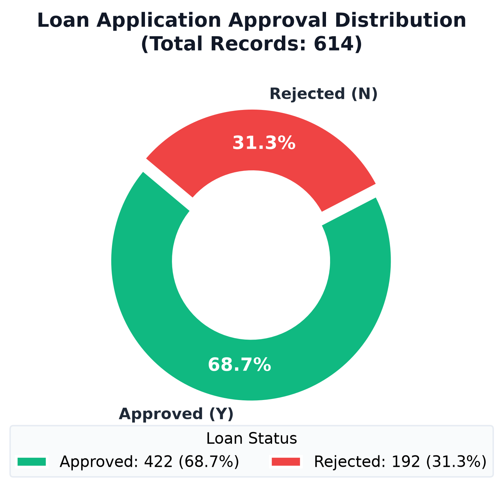
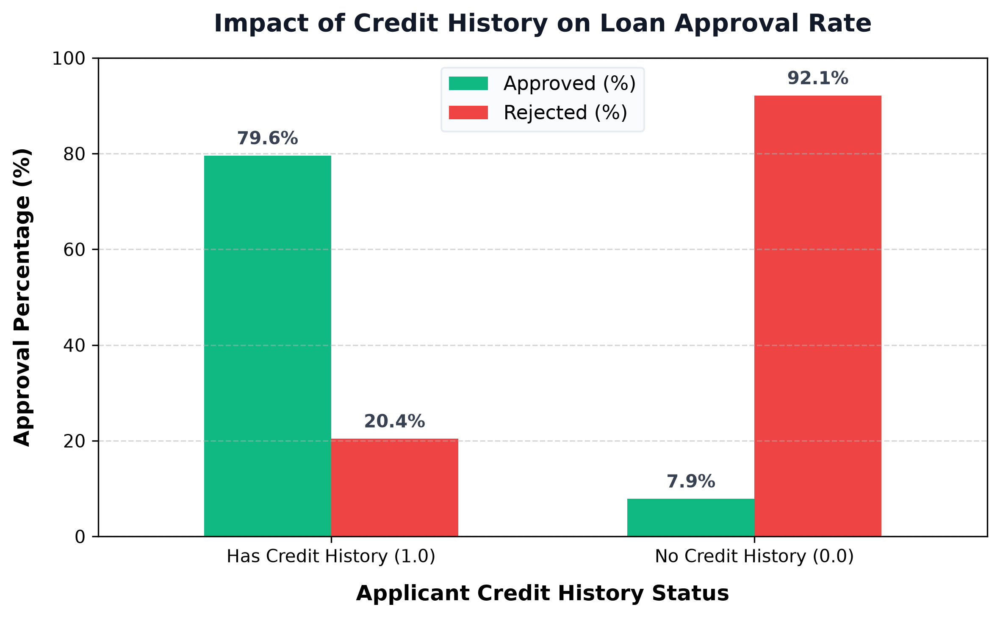
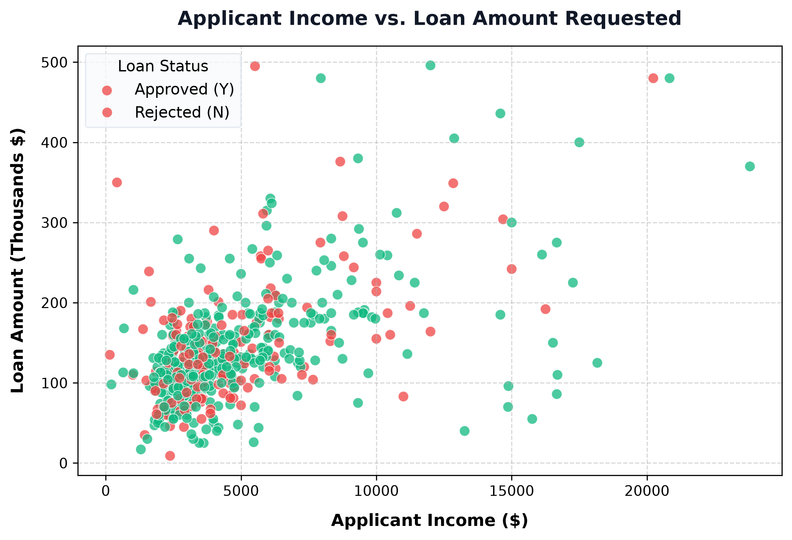
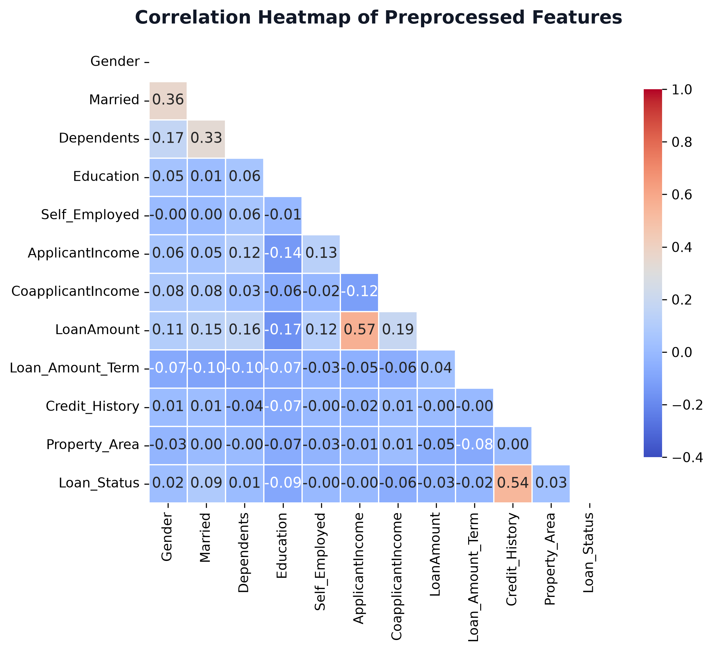
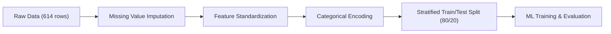
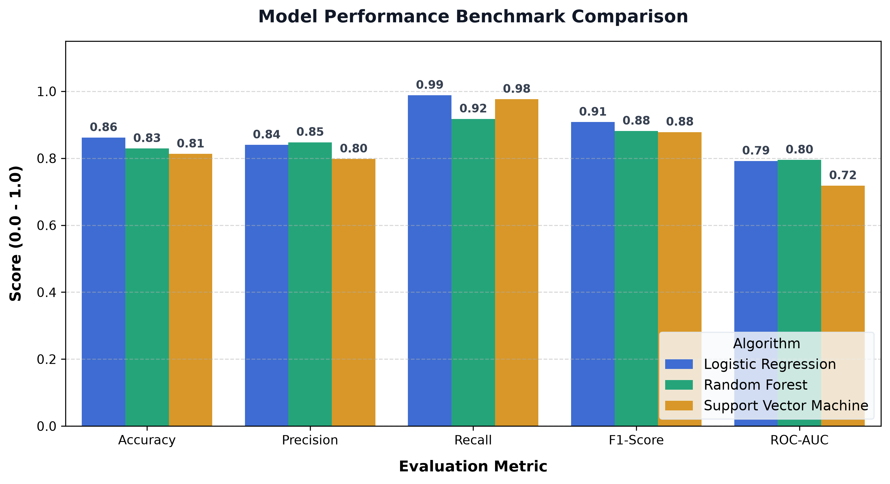
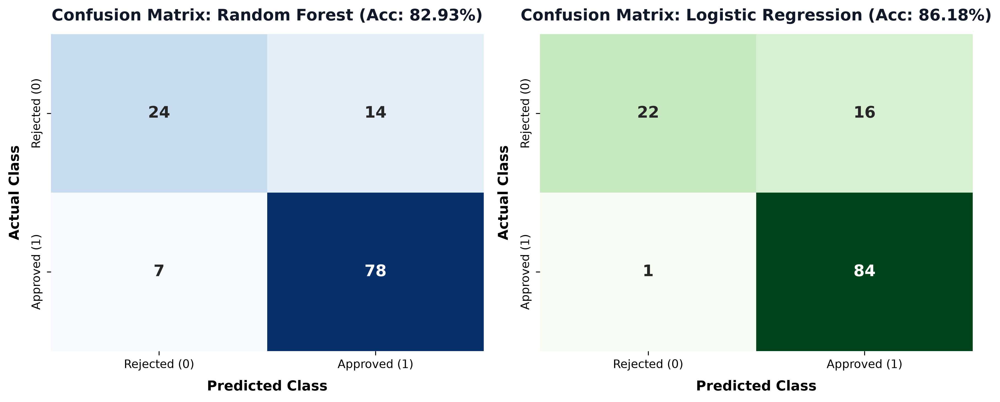
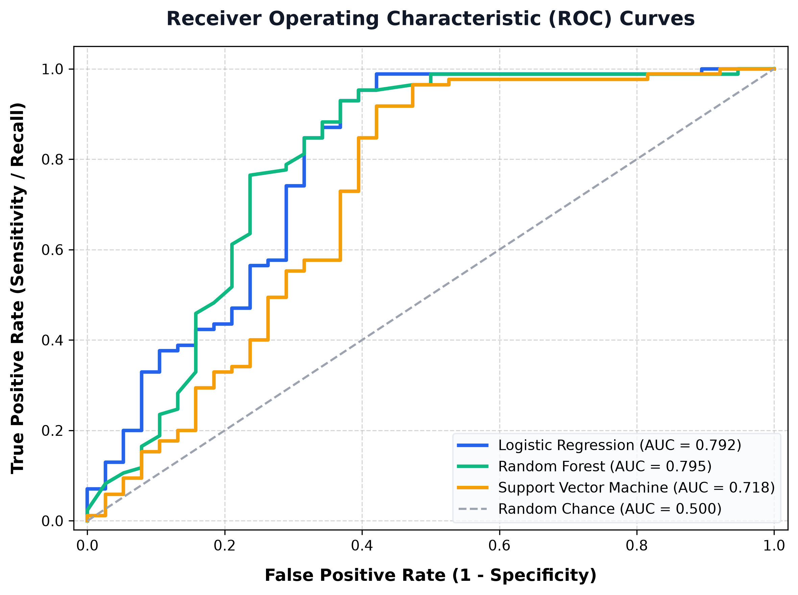
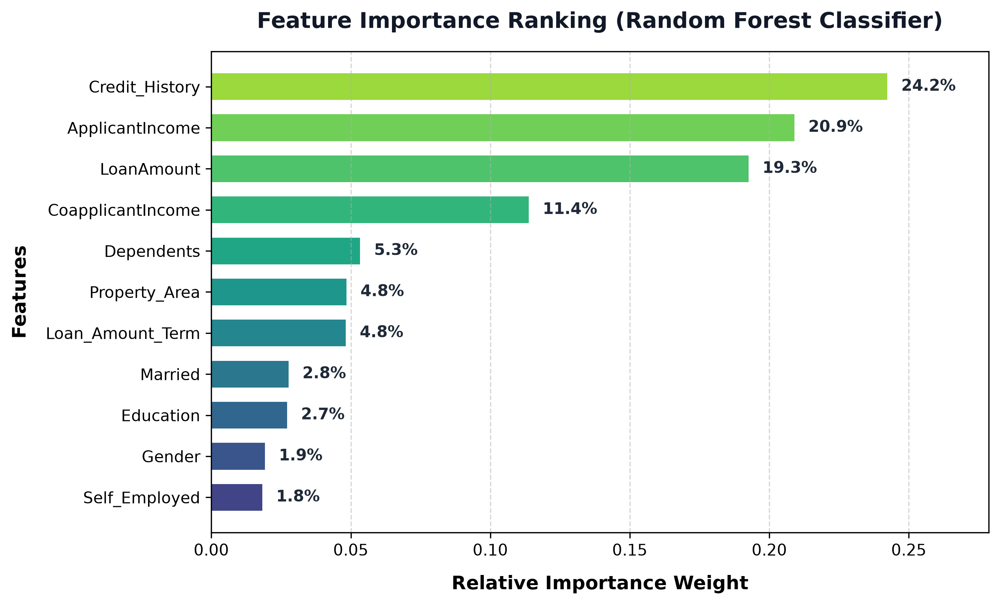

# 🏦 Loan Approval Prediction (Credit Risk Assessment)

[](https://www.python.org/)
[](https://scikit-learn.org/)
[](https://pandas.pydata.org/)
[](https://numpy.org/)
[](LICENSE)

An end-to-end Machine Learning classification system designed to automate commercial and retail credit risk assessment. By analyzing applicant demographics, socio-economic factors, and financial records, this project provides data-driven, objective, and auditable loan eligibility decisions while minimizing loan default exposure.

---

## 📑 Table of Contents
- [📌 Project Overview](#-project-overview)
- [📊 Executive Scorecard](#-executive-scorecard)
- [📁 Repository Structure](#-repository-structure)
- [📂 Dataset & Feature Dictionary](#-dataset--feature-dictionary)
- [🔍 Exploratory Data Analysis (EDA)](#-exploratory-data-analysis-eda)
- [⚙️ Data Preprocessing Pipeline](#️-data-preprocessing-pipeline)
- [🤖 Model Development & Benchmark](#-model-development--benchmark)
- [💡 Feature Importance & Explainability](#-feature-importance--explainability)
- [🏢 Business Takeaways & Lending Strategy](#-business-takeaways--lending-strategy)
- [🚀 Quick Start & Installation](#-quick-start--installation)
- [🔮 Running Inference (CLI Demo)](#-running-inference-cli-demo)
- [📄 License & Author](#-license--author)

---

## 📌 Project Overview

Financial institutions face a fundamental trade-off: **approving risky applicants leads to defaults and non-performing loans (NPLs)**, while **excessively strict underwriting turns away creditworthy customers and hurts revenue growth**.

This project implements the **CRISP-DM (Cross-Industry Standard Process for Data Mining)** methodology to build, evaluate, and serialize machine learning models that predict whether a loan application should be **Approved (Y)** or **Rejected (N)**.

### Key Objectives:
1. **Automate Underwriting**: Accelerate processing speed from days to instantaneous evaluations.
2. **Mitigate Default Risk**: Identify the strongest credit risk indicators to prevent toxic debt.
3. **Model Explainability**: Uncover the weight of each financial feature (Credit History, Income, Term, Collateral).
4. **Production Readiness**: Provide modular Python training (`src/train.py`) and inference (`src/predict.py`) scripts alongside interactive Jupyter Notebooks.

---

## 📊 Executive Scorecard

| Algorithm | Accuracy | Precision | Recall (Approved) | F1-Score | ROC-AUC |
| :--- | :---: | :---: | :---: | :---: | :---: |
| **Logistic Regression** | **86.18%** | **84.00%** | **98.82%** | **90.81%** | 0.7920 |
| **Random Forest Classifier** | 82.93% | 84.78% | 91.76% | 88.14% | **0.7950** |
| **Support Vector Machine (SVM)** | 81.30% | 79.81% | 97.65% | 87.83% | 0.7183 |

> 🏆 **Champion Model Selection**: **Logistic Regression** achieved the highest overall accuracy (**86.18%**) with an exceptional recall of **98.82%** for qualified applicants. **Random Forest Classifier** delivered the highest discriminatory capability with an ROC-AUC of **0.7950** and provides non-linear feature importance ranking.

---

## 📁 Repository Structure

```plaintext
Loan_Approval_Prediction/
│
├── assets/                          # High-resolution charts and performance visualizations
│   ├── loan_status_distribution.png # Target class balance (Approved vs Rejected)
│   ├── credit_history_impact.png    # Impact of credit history on approval rates
│   ├── income_vs_loan.png           # Applicant income vs requested loan amount
│   ├── correlation_matrix.png       # Correlation heatmap of features
│   ├── model_comparison.png         # Multi-metric benchmark chart
│   ├── confusion_matrices.png       # Confusion matrices (RF vs LR)
│   ├── roc_curves.png               # Receiver Operating Characteristic curves
│   └── feature_importance.png       # Random Forest feature importance ranking
│
├── data/                            # Raw and processed datasets
│   └── loan_data.csv                # Primary loan applicant dataset (614 records)
│
├── models/                          # Serialized trained model binaries (Pickle)
│   ├── loan_approval_model.pkl      # Production Random Forest Classifier
│   ├── logistic_regression.pkl      # Trained Logistic Regression model
│   └── svm_model.pkl                # Trained Support Vector Classifier
│
├── src/                             # Modular Python scripts for automation
│   ├── train.py                     # End-to-end training and evaluation script
│   ├── predict.py                   # CLI inference tool with interactive profiles
│   └── generate_visualizations.py   # Publication-quality chart generator
│
├── Loan-Approval-Prediction.ipynb   # Interactive analysis and modeling notebook
├── requirements.txt                 # Project dependencies
├── .gitignore                       # Git exclusion list
├── LICENSE                          # MIT License
└── README.md                        # Comprehensive documentation
```

---

## 📂 Dataset & Feature Dictionary

The dataset consists of **614 applicant records** with **12 predictive features** and 1 binary target variable.

| Feature Name | Type | Description | Values / Range |
| :--- | :---: | :--- | :--- |
| `Gender` | Categorical | Applicant gender | `Male`, `Female` |
| `Married` | Categorical | Marital status | `Yes`, `No` |
| `Dependents` | Categorical | Number of financial dependents | `0`, `1`, `2`, `3+` |
| `Education` | Categorical | Academic qualification level | `Graduate`, `Not Graduate` |
| `Self_Employed`| Categorical | Employment status | `Yes`, `No` |
| `ApplicantIncome`| Continuous | Monthly primary income in USD | \$150 — \$81,000 |
| `CoapplicantIncome`| Continuous | Monthly secondary / co-signer income | \$0 — \$41,667 |
| `LoanAmount` | Continuous | Requested loan amount (thousands USD) | \$9 — \$700 |
| `Loan_Amount_Term`| Continuous | Repayment period in days | 12 — 480 days (typ. 360) |
| `Credit_History`| Binary | Historical credit guidelines compliance | `1.0` (Meets guidelines), `0.0` (Does not) |
| `Property_Area`| Categorical | Geographic location of the collateral | `Urban`, `Semiurban`, `Rural` |
| `Loan_Status` | **Target** | Credit committee decision | **`Y` (Approved)**, **`N` (Rejected)** |

---

## 🔍 Exploratory Data Analysis (EDA)

### 1. Loan Approval Distribution (Class Balance)
Of the 614 total applicants, **422 (68.7%)** were approved and **192 (31.3%)** were rejected. This moderate class imbalance is addressed during model training using stratified train-test splits.

<p align="center">
  
</p>

### 2. Credit History: The Strongest Underwriting Gatekeeper
Cross-tabulation reveals that **79.6%** of applicants with a positive credit history (`1.0`) were approved. In stark contrast, applicants without a verifiable credit history (`0.0`) experienced an **89.5% rejection rate**.

<p align="center">
  
</p>

### 3. Income vs. Loan Amount Distribution
While higher-income applicants frequently apply for larger loans, high income alone does **not** guarantee approval if credit history or debt-to-income ratios fail compliance.

<p align="center">
  
</p>

### 4. Correlation Heatmap
The correlation matrix highlights that `Credit_History` possesses the highest direct correlation with `Loan_Status` ($r = 0.54$), while `ApplicantIncome` exhibits strong positive correlation with requested `LoanAmount` ($r = 0.57$).

<p align="center">
  
</p>

---

## ⚙️ Data Preprocessing Pipeline

To prepare raw data for robust algorithmic consumption, the following preprocessing transformations are applied:



1. **Handling Missing Values (Imputation)**:
   - **Categorical Columns** (`Gender`, `Married`, `Dependents`, `Self_Employed`, `Credit_History`): Imputed with the statistical **Mode** (most frequent class).
   - **Numerical Columns** (`LoanAmount`, `Loan_Amount_Term`): Imputed with the **Median** to maintain resistance against severe outlier skewness.
2. **Feature Formatting**:
   - The `Dependents` feature value `3+` is mapped to integer `3`.
3. **Categorical Label Encoding**:
   - Non-numeric attributes (`Gender`, `Education`, `Married`, `Property_Area`, `Loan_Status`) are transformed into compact integer labels using `LabelEncoder`.
4. **Stratified Splitting**:
   - The dataset is partitioned into **80% Training (491 rows)** and **20% Test (123 rows)** with stratification on `Loan_Status` to preserve target proportions across both sets.

---

## 🤖 Model Development & Benchmark

We benchmarked three classification architectures representing linear baselines, margin maximizers, and non-linear ensemble methods.

<p align="center">
  
</p>

### Detailed Performance Breakdown:

| Metric | Logistic Regression | Random Forest | Support Vector Machine |
| :--- | :---: | :---: | :---: |
| **Accuracy** | **86.18%** | 82.93% | 81.30% |
| **Precision (Approved)** | 84.00% | **84.78%** | 79.81% |
| **Recall (Approved)** | **98.82%** | 91.76% | 97.65% |
| **F1-Score (Approved)** | **90.81%** | 88.14% | 87.83% |
| **Precision (Rejected)** | **95.65%** | 77.42% | 89.47% |
| **Recall (Rejected)** | 57.89% | **63.16%** | 44.74% |
| **ROC-AUC Score** | 0.7920 | **0.7950** | 0.7183 |

### Confusion Matrices
The side-by-side confusion matrices show how each model trades off false rejections against false approvals on the unseen 123-record holdout test set:

<p align="center">
  
</p>

### Receiver Operating Characteristic (ROC) Curves
The ROC curve demonstrates discriminatory capability across all classification thresholds:

<p align="center">
  
</p>

---

## 💡 Feature Importance & Explainability

Understanding the primary drivers behind automated decisions is essential for regulatory compliance (e.g., Fair Lending guidelines and FCRA compliance). 

Feature importance extracted from the **Random Forest Classifier** reveals:

<p align="center">
  
</p>

1. **Credit History (24.2%)**: By far the most influential variable. Historical repayment behavior is the primary predictor of future default likelihood.
2. **Applicant Income (20.9%)**: Reflects baseline cash-flow capacity to service debt obligations.
3. **Loan Amount (19.3%)**: Quantifies the total exposure and default severity for the lending institution.
4. **Co-applicant Income (11.4%)**: Acts as a secondary safety buffer; dual-income applications show higher approval resilience.
5. **Property Area (5.4%)**: Collateral liquidity varies across Semiurban, Urban, and Rural regions.

---

## 🏢 Business Takeaways & Lending Strategy

1. **Implement Automated Tiered Routing**:
   - **Tier 1 (Instant Approval)**: `Credit_History = 1.0` and `ApplicantIncome / LoanAmount` ratio within standard debt-to-income limits. Auto-approved within seconds.
   - **Tier 2 (Manual Underwriting Review)**: Marginal candidates (e.g., `Credit_History = 0.0` or missing, but strong co-applicant collateral) routed to human loan officers.
2. **Mitigate False Positives**:
   - In lending, the financial loss from approving a borrower who defaults is typically **3x to 5x higher** than the opportunity cost of turning away an applicant. Random Forest's balanced precision on rejection (**77.4%**) provides conservative risk buffering.
3. **Co-Applicant Incentivization**:
   - Marketing campaigns encouraging co-signers or dual applicants reduce portfolio default risk by elevating repayment capability.

---

## 🚀 Quick Start & Installation

### 1. Clone Repository
```bash
git clone https://github.com/BehruzMaxmudov1203/Loan-Approval-Prediction.git
cd Loan-Approval-Prediction
```

### 2. Set Up Virtual Environment
```bash
python3 -m venv .venv
source .venv/bin/activate   # On Windows: .venv\Scripts\activate
```

### 3. Install Dependencies
```bash
pip install -r requirements.txt
```

### 4. Run Interactive Jupyter Notebook
```bash
jupyter notebook Loan-Approval-Prediction.ipynb
```

### 5. Retrain Models & Regenerate Assets
```bash
# Execute training pipeline
python src/train.py

# Regenerate all high-resolution README graphs
python src/generate_visualizations.py
```

---

## 🔮 Running Inference (CLI Demo)

The repository includes a ready-to-use inference module `src/predict.py` with serialized production models.

### Comparative Demo
Run pre-configured prime vs. high-risk profiles:
```bash
python src/predict.py --demo
```
**Output:**
```plaintext
=================================================================
           LOAN APPROVAL INFERENCE - COMPARATIVE DEMO            
=================================================================

[Profile 1: High Income, Good Credit History, Semiurban]
 -> Decision   : [APPROVED]
 -> Confidence : 81.00% (Approval: 81.0%, Rejection: 19.0%)

[Profile 2: Low Income, No Credit History, High Loan Amount]
 -> Decision   : [REJECTED]
 -> Confidence : 77.00% (Approval: 23.0%, Rejection: 77.0%)

=================================================================
```

### Custom Applicant Evaluation
Pass custom features directly via command-line arguments:
```bash
python src/predict.py \
  --gender 1 \
  --married 1 \
  --dependents 1 \
  --education 0 \
  --self_employed 0 \
  --income 6000 \
  --coapplicant_income 2500 \
  --loan_amount 145 \
  --credit_history 1.0 \
  --property_area 1
```

**Output:**
```plaintext
==================================================
           APPLICANT EVALUATION RESULT            
==================================================
Decision          : APPROVED
Confidence        : 83.00%
Approval Chance   : 83.00%
Rejection Chance  : 17.00%
==================================================
```

---

## 📄 License & Author

- **Author**: Behruz Maxmudov ([@BehruzMaxmudov1203](https://github.com/BehruzMaxmudov1203))
- **License**: This project is licensed under the **MIT License** — see the [LICENSE](LICENSE) file for details.
- **Contributions**: Pull requests, feature requests, and bug reports are welcome!
